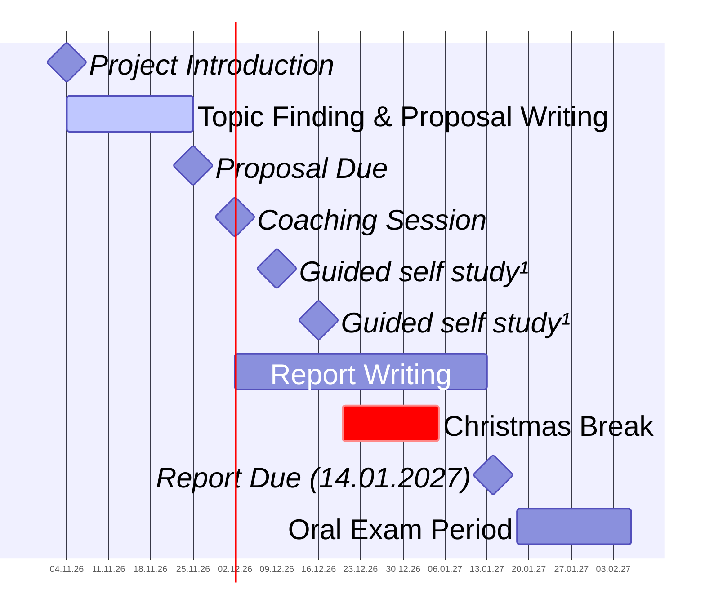

<!-- title slide: content is defined in frontmatter -->

---

# Today's Schedule

|    | Time          | What                                                        | Format              |
| -- | ------------- | ----------------------------------------------------------- | ------------------- |
| 1  | 08:00 – 08:35 | **Introduction** Project overview, deliverables & timeline  | Lecture             |
| 2  | 08:50 – 09:35 | **Researching data** Browse sources, find 3–4 datasets      | Individual work     |
| 3  | 09:50 – 10:35 | **Data bazar** Share datasets, formulate research questions | Pair work           |
| 4  | 10:50 – 11:35 | **Pitches** Present your ideas, get feedback                | Short pitches       |

---

<Inhalt :active="1" />

---

# What is the Semester Project?

- An **independent research project** — you define the question, find the data, run the analysis
- Apply methods from **one course block** to a real-world **environmental problem**
- A chance to go deeper than the exercises allow
- Individual project (no groups)

<!--
Emphasise that this is their project, not a prescribed exercise. The freedom is the point — but it also means they have to make real decisions. The environmental framing is important: methods alone are not enough, they need to connect to a meaningful question.
-->

---

# Workload in Context

As described in *Eventoweb*

|                                           |          |
| ----------------------------------------- | -------: |
| Contact hours (4h × 14 weeks)             |      56h |
| Guided Self-Study (Exercises)             |      34h |
| Independent Self-Study (Semester project) |  **60h** |
| **Total**                                 | **150h** |

60 hours is roughly **1.5 - 2 working weeks**: enough for a meaningful project, not enough to explore *everything*.

<!--
The 60h figure helps students calibrate scope. A common mistake is starting too broad. Encourage them to think: "what can I realistically finish in 60h, including writing?"
-->

---

# Project Forms

Your project can take one of several forms:

- **A**: Extension of a course exercise, going further than what was asked

<span v-mark.box.red="1">

- **B**: A spatial analysis component of another project you're already involved in
- **C**: A spatial component of an upcoming Project / BSc thesis

</span>

- **D**: Something entirely new

<div v-click="1">→ B / C: make clear in your proposal what is new in your project</div>


---

# Deliverables

|                                      | Assessment  | Format                           |
| ------------------------------------ | ----------- | -------------------------------- |
| **Proposal** + Coaching Session      | Pass / Fail | Quarto → PDF · Online Session     |
| **Written Report**                   | Pass / Fail | Quarto → PDF (8–12 pages)         |
| **Project Presentation** (Oral Exam) | Grade       | 10 min presentation + 10 min Q&A |

<!--
All three deliverables must be passed. Proposal and report are pass/fail — the grade comes entirely from the oral exam. Stress that the proposal is not a formality: it must be approved before they proceed.
-->

---

# Timeline



¹ *Guided self study*: Work on Project during class - we are here for guidance.

<!--
Students have 3 weeks to write the proposal while attending regular classes. The coaching happens before Christmas — they get feedback before doing the bulk of the work. The report is due mid-January so they have the break to work on it.
-->

---


# The Proposal & Coaching Session


- Proposal:
  - **Structure:**: Title, abstract, Research question, goals, expected results etc.
  - The proposal will be the basis for the coaching session
  - **Format:** Quarto template → render to PDF
- Coaching session:
  - You will pitch your idea
  - We provide ideas and ask critical questions
- **Assessment:** Pass / Fail

<!--
The proposal forces early thinking about feasibility. The risk analysis and Plan B are important — data access is the most common failure point. Encourage students to verify data availability *before* committing to a question.
-->

---

# The Written Report

**Structure:**
1. Introduction & Research Question
2. Methods
3. Results
4. Discussion
5. Conclusion

**Format:** Quarto template provided → render to PDF · 8–12 pages
**Assessment:** Pass / Fail

<!--
The Quarto template enforces structure and consistent formatting. Students do not need to include R code in the report — the focus is on the analysis and findings, not the implementation.
-->

---

# The Oral Exam

- **Date**: KW03-05 2027, exact date will be communicated by the administration on Freitag KW47
- **Duration:** 20 minutes per student
  - 10 min presentation
  - 10 min Q&A
- **Audience:** Two lecturers: Present as if to an informed client — skip the basics, focus on your findings
- **Key question:** Explain what you did, why you did it, and what it means
- **Grading:** 1–6, grading criteria announced separately

<!--
The Q&A probes depth of understanding. Students should expect questions about methodological choices, limitations, and alternative approaches. Encourage them to be honest about what didn't work.
-->


---

# What Makes a Good Research Question?

Given that the Module *Geocomputation* focuses on geodata processing methods, we recommend focussing on the following kind of research questions (RQs):

- **Methodological** RQs: Ask *how* a specific question can be answered and compare different approaches / methods
- **Spatial** RQs — the answer changes depending on *where*
- RQs embedded in an **environmental context**
- RQs specific and simple enough to answer within 60 hours — data is accessible, scope is bounded

<!--
The shift from "what/where" to "how can" keeps the focus on methods — which is what this course is about. Students who frame questions as pure spatial descriptions often end up just making a map. The "how can" framing forces a methodological argument.
-->

---

<Inhalt :active="2" />


---
layout: two-cols-header
---

# Researching Data


**Phase 1 — Explore** *(20 min, individual)*

Browse available datasets

- Scan the data sources listed (next slide)
- Focus on Geospatial data (or data that could be made spatial)
- Note anything that looks interesting

---
layout: two-cols-header
---

# Researching Data


**Phase 1 — Explore** *(20 min, individual)*

Browse available datasets

::left::

- [Opendata.swiss](https://opendata.swiss)
- [GBIF](https://gbif.org)
- [iNaturalist](https://inaturalist.org)
- [zueriwieneu.ch](https://zueriwieneu.ch)
- [MoveBank](https://movebank.org)
- [Kaggle](https://kaggle.com/datasets)
- [GeoLife](https://www.microsoft.com/en-us/research/publication/geolife-gps-trajectory-dataset-user-guide/)
- [Envidat](https://envidat.ch/)
- [Swisstopo](https://www.swisstopo.admin.ch/en/free-geodata-ogd)
- Anly other datasources you know...

::right::

<CountdownTimer :minutes="20" />

---

# Researching Data


**Phase 2 — Brainstorm** *(10 min)*

Now that you have a broad idea on what datasets are available, start thinking what kind of data you are actually interested in:

- What topics do you find interesting?
- What block do you want to cover (*Spatial Ecology & Occurence*, *Terrain & Water* or *Paths and Flows*)
- What kind of data do you need (point observations, raster data, networks...)

<CountdownTimer :minutes="10" />

---

# Researching Data


**Phase 3 — Refine** *(15 min, individual)*

With more detailed knowledge about what you are looking for, go back to the data sources.

Look for data that meet your requirements.


<CountdownTimer :minutes="15" />

---


<Inhalt :active="3" />

---
layout: two-cols-header
---

# Data-Speed-Dating

You'll pitch your dataset / ideas **3 times** to 3 different people.

- **Setup:** Arrange seats in two rows facing each other.
- **Each round (total 6 min):**
  1. Person A pitches 2 min
  1. Person B reacts  1 min 
  1. Person B pitches 2 min
  1. Person A reacts  1 min


---

# Prepare your pitch

Pick your **best 1–2 datasets** from the research phase. Be ready to explain:

- What does it contain? Spatial extent, resolution?
- What environmental question could it help answer?
- Which course block / methods does it connect to?

<CountdownTimer :minutes="5" />

---
layout: two-cols-header
---

# Round 1 / 3

::left::

Person A pitches 
<CountdownTimer :minutes="2" />

Person B reacts 
<CountdownTimer :minutes="1" />

::right::

Person B pitches 
<CountdownTimer :minutes="2" />

Person A reacts 
<CountdownTimer :minutes="1" />

---
layout: two-cols-header
---

# Round 3 / 3

::left::

Person A pitches 
<CountdownTimer :minutes="2" />

Person B reacts 
<CountdownTimer :minutes="1" />

::right::

Person B pitches 
<CountdownTimer :minutes="2" />

Person A reacts 
<CountdownTimer :minutes="1" />


---
layout: two-cols-header
---

# Round 3 / 3

::left::

Person A pitches 
<CountdownTimer :minutes="2" />

Person B reacts 
<CountdownTimer :minutes="1" />

::right::

Person B pitches 
<CountdownTimer :minutes="2" />

Person A reacts 
<CountdownTimer :minutes="1" />


---

# Write your Research Questions

*(rest of the lesson — individually)*

Based on your own datasets *and* what you heard: write **2–3 research questions** you could pursue.

- *How can…* (methodological angle)
- Answer changes depending on *where*
- Embedded in an environmental context
- Feasible in ~60h — data accessible, scope bounded

These are rough ideas — not your final proposal question.


---

<Inhalt :active="4" />

---

# Sharing Research Questions

3–4 volunteers share one research question in 2 minutes:

- State your dataset and research question
- Which course block / methods would you apply?


<!--
Keep feedback short (1–2 min per person). Focus on: is the RQ answerable? Is the data real and accessible? Is the scope bounded? Avoid going deep into methods at this stage.
-->

---

# Introduction to Quarto

The proposal (and later the report) are written in **Quarto** — a document system built on R Markdown.

- Markdown text → rendered to PDF
- Familiar if you've used R Markdown; cleaner syntax
- A template will be provided — you fill in the content

---

# Quarto Basics

````markdown
---
title: "My Project"
author: "Student Name"
format: pdf
---

## Heading

This is a paragraph with **bold** and *italic* text.

```{r}
# R Code
library(knitr)
kable(mtcars)
```
````

---

# Quarto Basics

**Hands on**

1. Start positron
2. Install the quarto extension
3. Create a new quarto file
4. Follow along


---


# The Proposal Template

Open the template and fill in:

1. **Title** — working title for your project
2. **Abstract** — 3–5 sentences: what, why, how
3. **Research Question** — your best candidate from today
4. **Data** — which dataset(s), where to get them

> This is a first draft — it will evolve before the deadline.

<!--
Walk through the template live. Show compilation (web editor or local). The goal is that every student leaves with a file open and at least a title written.
-->
