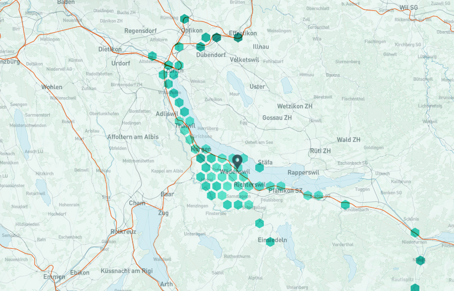

*Block:*  
<!-- add an "x" where appropriate -->

- [ ] Terrain & Water 
- [ ] Spatial Ecology & Occurrence
- [ ] Paths & Flows

*Project form:* 
<!-- add an "x" where appropriate -->

- [ ] A: Extension of a course exercise, going further than what was asked
- [ ] B: Spatial analysis component of another project you are already involved in
- [ ] C: Spatial component of an upcoming project / BSc thesis
- [ ] D: Something entirely new


# Research Question & Goals

**Main research question:**

...

**Goals:**

1. First goal — what will you do or produce?
2. Second goal
3. Third goal *(optional)*


# Delimitation from Parent Project

*(Forms B and C only — delete this section for A or D)*

Briefly describe the parent project. Then explain clearly what is *new* in your
semester project: what is the specific spatial/methodological contribution, and
how does it differ from or extend the existing work?

# Data Sources

<!-- Edit data/datasources.csv to list your datasets — one row per dataset.     -->
<!-- Verify that you can actually download each dataset before submitting.       -->

```{r}
#| echo: false
#| message: false
library(readr)
library(knitr)
read_csv("datasources.csv") |> 
  kable()
```





# Expected Results

Describe the expected outputs concretely: maps, plots, tables, statistical
summaries, comparisons between methods or areas. What will you hand in as
evidence that the project is done?

# Methods

Describe your planned analytical workflow step by step. Mention the R packages,
functions, or algorithms you plan to use. If you are comparing methods, name both.
You do not need to know every detail yet — but show that you have thought through
the main steps.

# Timeline

<!-- Think about when you will do what as realistically as possible -->
<!-- implement this in a mermaid gantt chart: https://mermaid.ai/open-source/syntax/gantt.html -->

```{mermaid}
%%| label: fig-timeline
%%| fig-cap: Project timeline
%%{init: {'theme': 'neutral'}}%%
gantt
    dateFormat  YYYY-MM-DD
    axisFormat  %d.%m
    tickInterval 1week
    weekday wednesday

    section Milestones
    Proposal Due (25.11)   :milestone, 2026-11-25, 0d
    Coaching (02.12)       :milestone, 2026-12-02, 0d
    Report Due (14.01)     :milestone, 2027-01-14, 0d
    Oral Exam (18.01, tbd) :milestone, 2027-01-18, 0d

    section Report
    Analysis & writing     :w1, 2026-12-02, 2026-12-20
    Analysis & writing     :w2, 2027-01-05, 2027-01-13

    section Break
    Christmas Break        :crit, 2026-12-20, 2027-01-05
```

# Risk Analysis & Plan B


::: {.list-table}
- - Risk
  - Likelihood
  - Mitigation / Plan B

- - Data not freely accessible
  - Medium
  - Use alternative dataset (name it)

- - ....
  - ....
  - ....
:::

# Questions for the Coaching Session

1. How can I...
2. Do you think...
3. What if...
